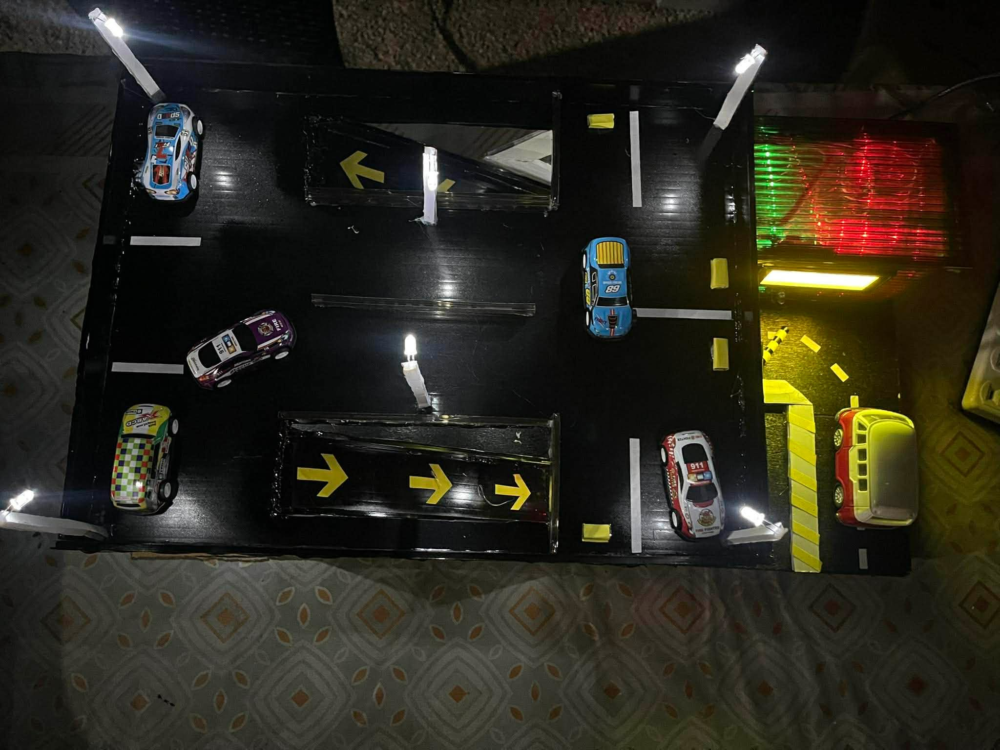
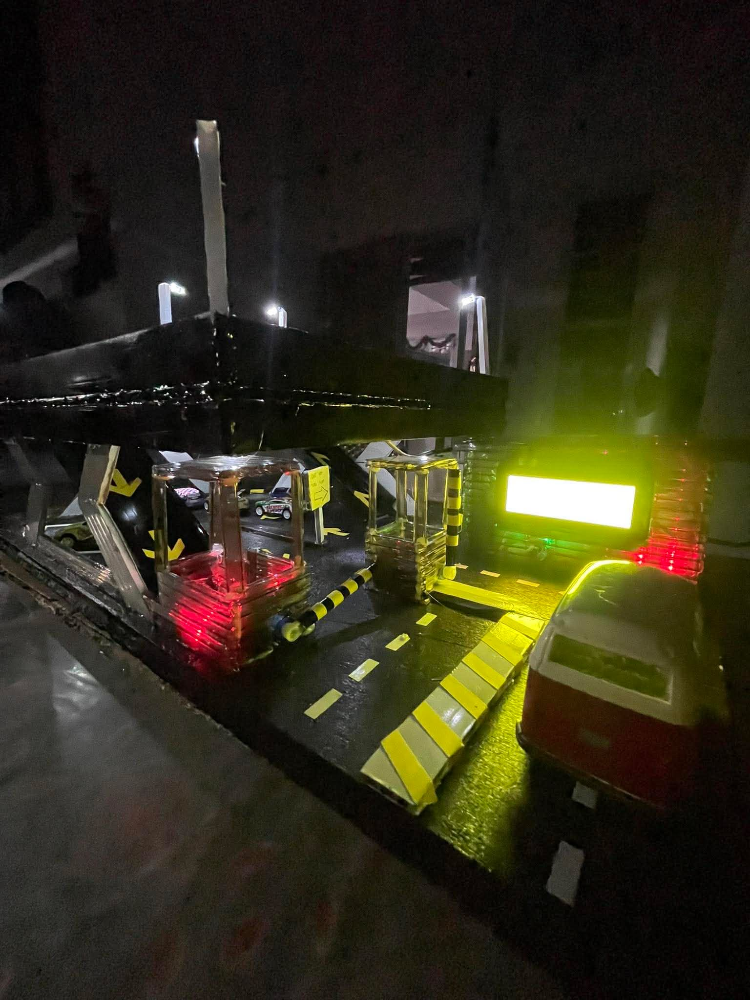
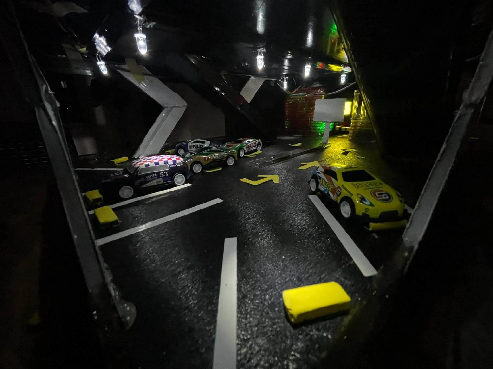
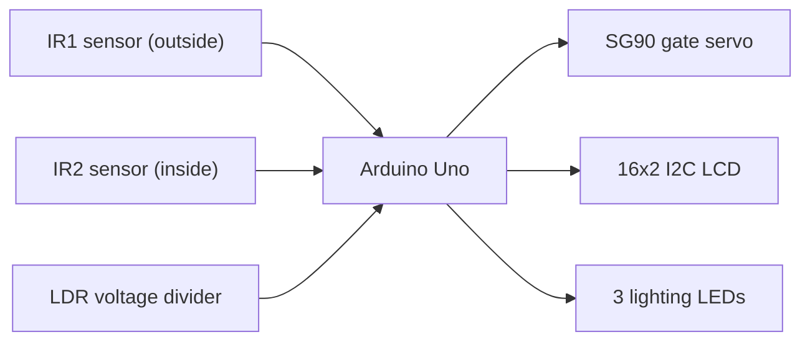
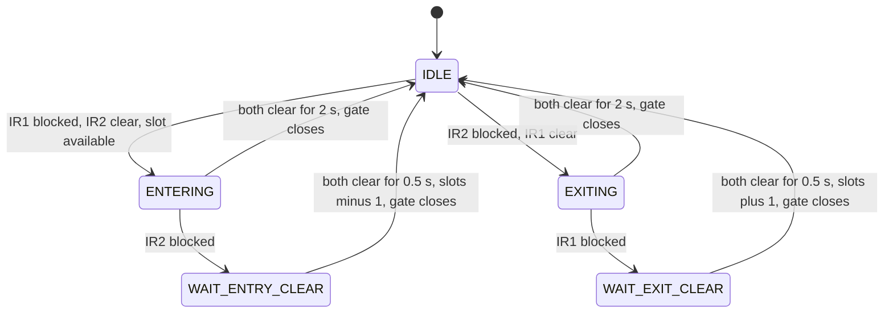

<div align="center">

**ARDUINO UNO · SENSORS · SERVO CONTROL**

# Automatic Parking System

### Detect a vehicle. Move the gate. Keep count.

[Overview](#project-overview) · [System design](#system-design) · [Hardware](#hardware-needed) · [Setup](#how-to-use) · [Contact the developer](mailto:louise.catala24@gmail.com)

</div>

<p align="center">
  
</p>

<p align="center"><em>The finished four-slot parking model, seen from above with its LED lighting on.</em></p>

## Project overview

A four-slot parking model that brings together vehicle detection, a servo-operated gate, an LCD slot counter, and light-sensitive illumination. It demonstrates how several small inputs and outputs can work together as one embedded system, all driven by a single Arduino Uno.

| At a glance | What it means |
| --- | --- |
| **Detect** | Two IR sensors monitor vehicles at the entrance and the inside of the gate |
| **Respond** | A servo moves the model gate arm |
| **Inform** | The LCD shows the gate status and available slots |
| **Illuminate** | An LDR switches three LED lamps on when it gets dark |

## Features

- Opens the gate automatically for entering and leaving cars.
- Shows live status messages and the number of available slots on a 16×2 LCD.
- Refuses entry when all four slots are taken, while still letting cars leave.
- Counts a car only after it has fully passed through the gate, so a car that backs out is not counted.
- Turns the lights on when dark and off when bright, with a gap between the two thresholds to prevent flickering.
- Runs as a non-blocking state machine, so lighting and display keep updating while the gate is moving.

## Gallery

<p align="center">
  
</p>

<p align="center"><em>Entrance side: gate booth, striped gate arm and the glowing LCD display.</em></p>

<p align="center">
  
</p>

<p align="center"><em>Inside the model: marked parking bays, wheel stops, lane arrows and overhead LED lighting.</em></p>

<p align="center">
  
</p>

<p align="center"><em>Original wiring illustration extracted from Circuit Diagram.pdf. This is a circuit illustration, not a photograph of the build.</em></p>

[View the Arduino sketch](Parking_System_CODE.ino) · [Open the full circuit diagram](Circuit%20Diagram.pdf)

## System design

### Block diagram



| Block | Role |
| --- | --- |
| **IR1 (outside)** | Detects a car approaching the gate from the street side |
| **IR2 (inside)** | Detects a car approaching the gate from the parking side |
| **LDR divider** | Gives the Arduino an analog reading of ambient light |
| **Arduino Uno** | Reads inputs, runs the gate logic, drives all outputs |
| **SG90 servo** | Raises and lowers the model gate |
| **I2C LCD** | Displays status and slot count |
| **LEDs** | Lamp posts that switch on automatically in the dark |

### Direction detection

The two IR sensors sit on either side of the gate. The order in which they trigger tells the system which way the car is travelling:

- **Entering:** IR1 (outside) triggers first, then IR2 (inside).
- **Leaving:** IR2 (inside) triggers first, then IR1 (outside).

The sensor modules pull their output **LOW** when something is detected, and the sketch reads them that way.

### Gate state machine

The sketch uses five states instead of delay calls, so the lights and display never freeze while the gate waits for a car to pass.



| State | What is happening |
| --- | --- |
| `IDLE` | Gate closed, waiting for a car at either sensor |
| `ENTERING` | Gate open for an arriving car, waiting for it to reach the inside sensor |
| `EXITING` | Gate open for a departing car, waiting for it to reach the outside sensor |
| `WAIT_ENTRY_CLEAR` | Car has reached the inside sensor, waiting for both sensors to clear |
| `WAIT_EXIT_CLEAR` | Car has reached the outside sensor, waiting for both sensors to clear |

If a car triggers a sensor and then reverses away without passing through, both sensors clear for 2 seconds, the gate closes, and the slot count is left unchanged.

### Automatic lighting

The LDR is wired as a voltage divider, so a higher analog reading means more light. The sketch uses two thresholds (hysteresis) so the lamps do not flicker around a single cut-off point:

| Reading (0–1023) | Result |
| --- | --- |
| Below `450` | Lamps turn **on** |
| Above `550` | Lamps turn **off** |
| Between `450` and `550` | Lamps keep their current state |

### LCD messages

| Line 1 | When it appears |
| --- | --- |
| `Parking Ready` | Gate closed and both sensors clear |
| `Car Entering` | Gate opened for an arriving car |
| `Car Leaving` | Gate opened for a departing car |
| `Parking Full` | A car is at the entrance sensor and no slots are left |

Line 2 always shows the live count in the form `Slots: N / 4`. The display only rewrites itself when the message or the count changes, which avoids flicker.

## Hardware Needed

- 1 Arduino Uno
- 2 IR obstacle sensors
- 1 SG90 positional servo
- 1 16×2 LCD with I2C module
- 1 LDR
- 1 10kΩ resistor
- 3 LEDs
- 3 330Ω resistors
- Breadboard and jumper wires
- USB cable
- Suitable regulated 5V servo supply
- Model gate and parking base

## Connections

| Component | Arduino Pin |
| --- | --- |
| IR1 OUT (outside) | D2 |
| IR2 OUT (inside) | D3 |
| Servo signal | D4 |
| LED 1, 2, 3 | D8, D9, D10 |
| LDR divider | A0 |
| LCD SDA / SCL | A4 / A5 |

Wiring notes:

- Each LED needs its own series 330Ω resistor.
- LDR wiring: 5V → LDR → A0 → 10kΩ resistor → GND.
- Power the servo from a suitable regulated 5V supply rather than the Arduino 5V pin if the gate stutters or the board resets.
- Connect all grounds together, including the servo supply ground.

## Software Settings

All tunable values are constants at the top of `Parking_System_CODE.ino`.

| Constant | Default | Purpose |
| --- | --- | --- |
| `CAPACITY` | `4` | Total number of parking slots |
| `OPEN_ANGLE` | `0` | Servo angle with the gate open |
| `CLOSED_ANGLE` | `100` | Servo angle with the gate closed |
| `DARK_THRESHOLD` | `450` | LDR reading below which the lamps turn on |
| `BRIGHT_THRESHOLD` | `550` | LDR reading above which the lamps turn off |
| `CLEAR_TIME` | `500` | Milliseconds both sensors must stay clear before a car is counted |
| LCD address | `0x27` | I2C address passed to `LiquidCrystal_I2C` |

## How to Use

1. Connect the hardware following the table above.
2. In Arduino IDE, open **Sketch → Include Library → Manage Libraries** and install the **LiquidCrystal I2C** library. The **Servo** library is included with the IDE.
3. Open `Parking_System_CODE.ino` in Arduino IDE. If the IDE offers to move it into a folder of the same name, accept.
4. Select **Arduino Uno** under **Tools → Board** and the correct port under **Tools → Port**.
5. Click **Upload**.
6. Test: pass a toy car in front of the outside sensor, then the inside sensor, and watch the gate and the slot count.

## Limitations

- Designed for **one car at a time** through the gate.
- The slot count is held in memory only, so it **resets to four** whenever the Arduino restarts.
- The system counts cars passing the gate; it does not sense whether each individual bay is occupied.

## Troubleshooting

| Problem | What to check |
| --- | --- |
| LCD is lit but shows no text | Adjust the contrast potentiometer on the I2C backpack, or try a different I2C address if `0x27` does not work |
| Gate moves but is jittery or the board resets | Use a separate regulated 5V supply for the servo and share the ground |
| Gate opens the wrong way | Swap the values of `OPEN_ANGLE` and `CLOSED_ANGLE`, or adjust them to fit your gate |
| Cars are counted in the wrong direction | Swap the IR1 and IR2 sensor positions or their pin assignments |
| Lights flicker or never switch | Check the LDR divider wiring and adjust `DARK_THRESHOLD` and `BRIGHT_THRESHOLD` for your room |

## Project structure

```text
Automatic-Parking-System/
├── Parking_System_CODE.ino
├── Circuit Diagram.pdf
├── README.md
└── docs/
    └── images/
        ├── circuit-preview.png
        ├── parking.jpg
        ├── parking2.jpg
        └── parking3.jpg
```

---

## License and Support

Copyright © 2026 Orland Louise Catala. All rights reserved for my original work, except where an existing license states otherwise. Third-party materials remain subject to their respective licenses.

Please do not copy, modify, redistribute, sell, or claim my original project files as your own without my permission.

I’m a student developer with limited financial resources, and these projects represent many hours of effort. Please respect and support my work. If you would like a copy of the project files, contact me at **[louise.catala24@gmail.com](mailto:louise.catala24@gmail.com)** to discuss a cheap price. Your support helps me continue studying and creating.
