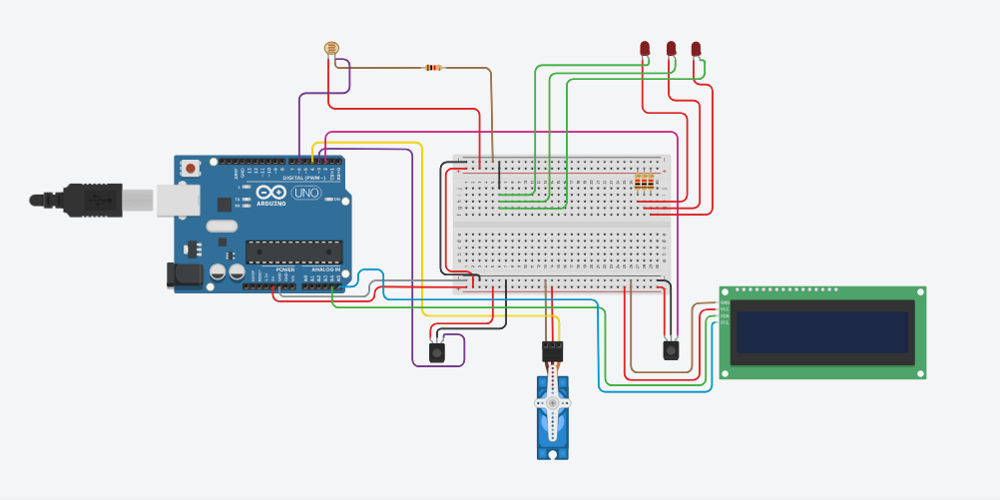

**ARDUINO UNO · SENSORS · SERVO CONTROL**

# Automatic Parking System

### Detect a vehicle. Move the gate. Keep count.

[Explore the project](#project-overview) · [Documentation](#project-documentation) · [Contact the developer](mailto:louise.catala24@gmail.com)

  

<em>Original wiring illustration extracted from Circuit Diagram.pdf. This is a circuit illustration, not a photograph of a completed build.</em>

## Project overview

A four-slot parking model brings together vehicle detection, a servo-operated gate, an LCD counter, and light-sensitive illumination. It demonstrates how several small inputs and outputs can work together as one embedded system.

| At a glance | What it means |
| --- | --- |
| **Detect** | Two IR sensors monitor vehicle movement |
| **Respond** | A servo moves the model gate |
| **Inform** | The LCD shows available slots |

## Follow a vehicle through the system

The intended sequence is straightforward: detect entry or exit, operate the gate, and update the slot count. An LDR provides the lighting input. The documented model handles one car at a time and resets to four available slots after restarting. The current sketch filename is `Parking_System_CODE.ino`; use that file when following the preserved setup notes.

[View the Arduino sketch](Parking_System_CODE.ino) · [Open the full circuit diagram](Circuit%20Diagram.pdf)

## Project documentation

<strong>Open the original project notes, files, and setup instructions</strong>

# Automatic Parking System

An Arduino-based four-slot parking system with an automatic gate, LCD slot counter, and automatic lights.

## Hardware Needed

- 1 Arduino Uno
- 2 IR obstacle sensors
- 1 SG90 positional servo
- 1 16×2 LCD with I2C module
- 1 LDR
- 1 10kΩ resistor
- 3 LEDs
- 3 330Ω resistors
- Breadboard and jumper wires
- USB cable
- Suitable regulated 5V servo supply
- Model gate and parking base

## Connections

| Component | Arduino Pin |
|---|---|
| IR1 OUT | D2 |
| IR2 OUT | D3 |
| Servo signal | D4 |
| LED 1, 2, 3 | D8, D9, D10 |
| LDR divider | A0 |
| LCD SDA / SCL | A4 / A5 |

Each LED needs a series 330Ω resistor.

LDR wiring: 5V → LDR → A0 → 10kΩ resistor → GND.

Connect all grounds together.

## How to Use

1. Connect the hardware.
2. Install the Servo and LiquidCrystal_I2C libraries.
3. Open `Parking_System.ino` in Arduino IDE.
4. Select Arduino Uno and the correct port.
5. Upload and test.

## Features

- Opens the gate for entering and leaving cars.
- Displays available parking slots.
- Turns lights on when dark.

## Notes

Adjust servo angles, LCD address, and light thresholds as needed. Slots reset to four after restarting. Designed for one car at a time.

---

## License and Support

Copyright © 2026 Orland Louise Catala. All rights reserved for my original work, except where an existing license states otherwise. Third-party materials remain subject to their respective licenses.

Please do not copy, modify, redistribute, sell, or claim my original project files as your own without my permission.

I’m a student developer with limited financial resources, and these projects represent many hours of effort. Please respect and support my work. If you would like a copy of the project files, contact me at **[louise.catala24@gmail.com](mailto:louise.catala24@gmail.com)** to discuss a cheap price. Your support helps me continue studying and creating.
